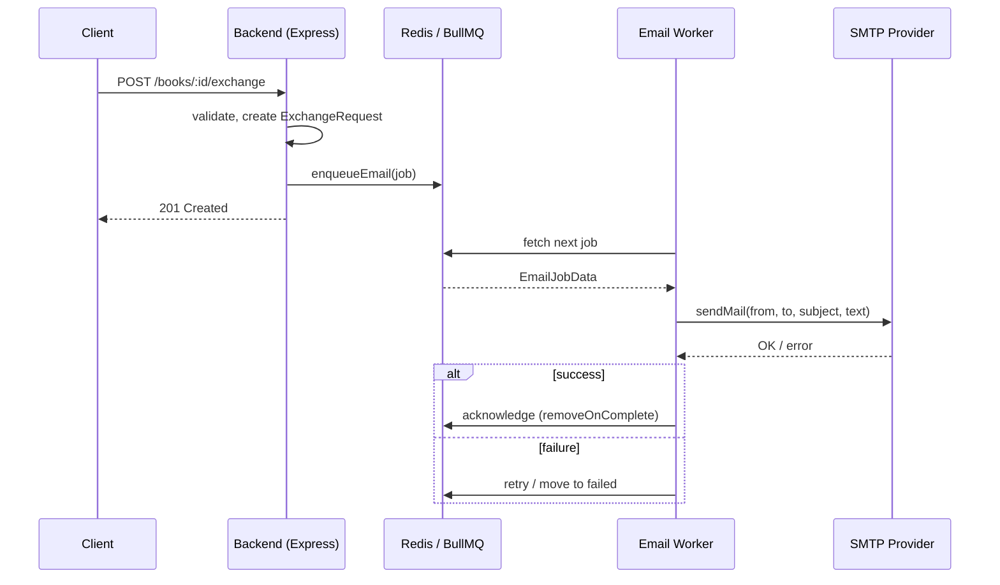

# Book Swap

A full-stack web application for discovering, listing, and exchanging books between users. Users can register, manage their book collection (with optional cover images), browse the catalog with search and pagination, request exchanges, and receive email notifications when someone wants to swap for their books. Administrators have additional user-management capabilities.

**Live demo:** http://3.94.153.209  
**Repository:** https://github.com/rogozianartemdev-del/book-swap

---

## Features

Based on the implemented routes, services, models and UI pages:

- **Authentication**
  - User registration and login with JWT (Bearer token).
  - Password hashing with bcrypt.
  - Role-based access (`user` / `admin`).
  - Rate limiting on auth endpoints (30 requests / 15 min).

- **Book catalog**
  - Public list of books with search (name / author, case-insensitive), sorting and pagination.
  - Book details view (includes owner info).
  - Authenticated users can add their own books (name, author, optional description, optional cover via URL or file upload).
  - Users can list and delete their own books; admins can delete any book.
  - Cover images are stored on disk and served under `/uploads`.

- **Exchange requests**
  - Authenticated users can request an exchange for any book they do not own.
  - One request per user per book (unique constraint).
  - Book owner receives an email with requester details and the requester’s current book list.
  - Owners can list incoming exchange requests for their books.

- **User profile**
  - View and update own profile (name, optional avatar upload).

- **Admin panel**
  - List, create, update and delete users (protected by role check).
  - Cannot delete own account.

- **Supporting infrastructure**
  - Health-check endpoint.
  - Structured error handling (custom `ApiError`, Zod validation, Multer errors).
  - Database migrations and seeders (demo users, books and exchange requests).
  - Asynchronous email delivery via Redis + BullMQ.

---

## Tech Stack

| Layer              | Technology                          | Version / Notes                                      |
|--------------------|-------------------------------------|------------------------------------------------------|
| **Client**         | React + TypeScript + Vite           | React 19.3, Vite 8.3, TypeScript ~7.0                 |
|                    | UI                                  | Ant Design 6.7, Bootstrap 5.3, Tailwind CSS 3.4, Lucide React |
|                    | Data fetching / routing             | TanStack React Query 5, React Router 7, Axios        |
| **Backend**        | Node.js + Express + TypeScript      | Node 22 (Docker), Express 5.3, TypeScript 7, tsx     |
|                    | Validation                          | Zod 4                                                |
|                    | Auth                                | jsonwebtoken 9, bcrypt 6                             |
|                    | File uploads                        | Multer 2                                             |
|                    | Rate limiting                       | express-rate-limit 8                                 |
| **Database**       | PostgreSQL + Sequelize              | Postgres 18-alpine, Sequelize 6.37, sequelize-cli    |
| **Queue / Broker** | Redis + BullMQ                      | Redis 7-alpine, BullMQ 6.7, ioredis 6                |
| **Email**          | Nodemailer                          | 10.6 (SMTP)                                          |
| **Deployment**     | Docker Compose                      | Multi-stage Dockerfiles (Node 22-alpine, nginx 1.27-alpine) |
| **Admin UI (DB)**  | Adminer                             | 5                                                    |

---

## Architecture Overview

```
┌─────────────┐         HTTP (JSON / multipart)          ┌──────────────────────┐
│   Browser   │ ───────────────────────────────────────► │  Client (React SPA)  │
│             │ ◄─────────────────────────────────────── │  nginx (prod) / Vite │
└─────────────┘                                          └──────────┬───────────┘
                                                                    │
                                                                    │ VITE_API_URL
                                                                    ▼
                                                         ┌──────────────────────┐
                                                         │  Backend (Express)   │
                                                         │  + Email Worker      │
                                                         │  (same process)      │
                                                         └──────┬───────┬───────┘
                                                                │       │
                         ┌──────────────────────────────────────┘       │
                         │                                              │
                         ▼                                              ▼
                ┌─────────────────┐                            ┌─────────────────┐
                │  PostgreSQL     │                            │  Redis          │
                │  (users, books, │                            │  (BullMQ queue) │
                │   exchange_     │                            │                 │
                │   requests)     │                            └────────┬────────┘
                └─────────────────┘                                     │
                                                                        │ job
                                                                        ▼
                                                               ┌─────────────────┐
                                                               │  SMTP Provider  │
                                                               │  (Nodemailer)   │
                                                               └─────────────────┘
```

### Request flow (typical authenticated request)

1. Browser → Client (React) makes an Axios request with `Authorization: Bearer <jwt>`.
2. Client → Backend (`/books`, `/me/*`, `/users`, …).
3. Backend middleware chain: CORS → JSON body parser → (optional rate limiter) → `authenticate` (JWT verification) → route-specific validation / upload → controller → service.
4. Service uses Sequelize models to read/write PostgreSQL.
5. For exchange requests the service also enqueues an email job to Redis (BullMQ).
6. Response is returned as JSON; the email worker (started in the same Node process) later consumes the job and sends mail via SMTP.

### Main architectural decisions

- **JWT + role claims** – stateless authentication; role is embedded in the token and checked by the `authorize` middleware for admin routes.
- **BullMQ + Redis for email** – sending email is moved out of the HTTP request path so that SMTP latency or temporary failures do not affect API response time. Retries and backoff are handled by the queue.
- **Email worker co-located with the API process** – simplifies local development and Docker Compose (no extra service). The worker is started in `server.ts` after DB and SMTP verification.
- **Sequelize + explicit migrations** – schema is version-controlled; `uuidv7()` is used for primary keys.
- **File uploads on local disk** – covers and avatars are stored under `uploads/` and served statically; the error handler cleans up failed uploads.
- **Clean separation on the client** – domain entities / repository interfaces, data-layer implementations (API + storage), and presentation (pages + hooks) follow a lightweight clean-architecture style.

---

## Project Structure

```
book-swap/
├── .env.example                 # Root environment variables (used by docker-compose)
├── .gitignore
├── docker-compose.yml
├── backend/
│   ├── Dockerfile               # multi-stage: base → dev / prod
│   ├── package.json
│   ├── .sequelizerc
│   ├── tsconfig.json
│   └── src/
│       ├── app.ts               # Express app, middleware & route mounting
│       ├── server.ts            # DB connect, SMTP verify, start worker, listen
│       ├── config/
│       │   ├── config-env.ts    # Zod-validated environment
│       │   ├── redis.ts         # BullMQ connection options
│       │   └── sequelize-cli.ts # CLI config for migrations/seeders
│       ├── database/
│       │   ├── sequelize.ts     # Sequelize instance
│       │   ├── index.ts         # model registration & associations
│       │   ├── models/          # User, Book, ExchangeRequest
│       │   ├── migrations/      # create-users, create-books, create-exchange-requests
│       │   └── seeders/         # demo users, books, exchange requests
│       ├── middlewares/         # authenticate, authorize, validate, upload, rate-limiter, error-handler
│       ├── modules/
│       │   ├── auth/            # register / login, JWT helpers
│       │   ├── books/           # catalog + personal books CRUD
│       │   ├── exchange/        # request exchange + email builder
│       │   ├── profiles/        # current-user profile
│       │   └── users/           # admin user management
│       ├── queues/
│       │   ├── email.queue.ts   # Queue definition & enqueue helper
│       │   └── email.worker.ts  # Worker + Nodemailer transporter
│       ├── types/               # Express Request augmentation
│       └── utils/               # ApiError, pagination, password, uploads, …
└── client/
    ├── Dockerfile               # multi-stage: Vite build → nginx
    ├── nginx.conf               # SPA fallback
    ├── package.json
    ├── index.html
    └── src/
        ├── main.tsx / App.tsx
        ├── application/         # AuthContext, DI container
        ├── config/              # VITE_API_URL
        ├── data/                # HTTP client, API repositories, local storage
        ├── domain/              # entities + repository interfaces
        └── presentation/        # pages, layouts, components, routes
```

---

## Docker Compose (detailed)

### Services

| Service   | Image / Build                          | Ports          | Volumes                          | Networks (default) | Depends on          | Restart          | Healthcheck / Notes |
|-----------|----------------------------------------|----------------|----------------------------------|--------------------|---------------------|------------------|---------------------|
| `db`      | `postgres:18-alpine`                   | `5432:5432`    | `pg_data:/var/lib/postgresql`    | bridge             | –                   | –                | `pg_isready` every 5s, 10 retries |
| `redis`   | `redis:7-alpine`                       | (internal)     | –                                | bridge             | –                   | –                | `redis-cli ping` every 5s |
| `backend` | build `./backend` (target `dev`)       | `${PORT}:${PORT}` (default 4000) | `./backend:/app`, anonymous `/app/node_modules` | bridge | `db` (healthy), `redis` (healthy) | – | Uses root `.env` |
| `client`  | build `./client` (ARG `VITE_API_URL`)  | `3000:80`      | –                                | bridge             | `backend`           | –                | nginx serves built SPA |
| `adminer` | `adminer:5`                            | `8080:8080`    | –                                | bridge             | `db` (healthy)      | `unless-stopped` | Default server = `db` |

### Why each service exists

- **db** – Persistent relational storage for users, books and exchange requests. Without it the API cannot start (`sequelize.authenticate()` fails).
- **redis** – Message broker for BullMQ. Without it the email queue cannot be created and the worker cannot start.
- **backend** – The Node/Express API + co-located email worker. The volume mount enables hot-reload in development (`tsx watch`).
- **client** – Production-ready static SPA served by nginx. Built with the correct `VITE_API_URL` at image-build time.
- **adminer** – Convenient web UI for inspecting the PostgreSQL database during development.

### Communication

- All services share the default Docker Compose network.
- Backend reaches the database via hostname `db` (port 5432) and Redis via hostname `redis` (port 6379) – values taken from environment variables.
- Client (browser) talks to the backend using the URL provided by `VITE_API_URL` (in the example: `http://localhost:4000`).
- Adminer connects to the database using the hostname `db`.

### Startup order & persistence

1. `db` and `redis` start and become healthy.
2. `backend` starts, authenticates to Postgres, verifies SMTP, starts the BullMQ worker, then listens.
3. `client` and `adminer` start after their dependencies.

Data persistence is provided by the named volume `pg_data`. Uploaded files live inside the backend container (or the bind-mounted `./backend` directory in dev) under `uploads/`.

---

## Email Sender System (detailed)

### Trigger

The only email currently implemented is sent when a user creates an exchange request:

```ts
// exchange.service.ts
await enqueueEmail(buildExchangeRequestEmail({ book, owner, requester, requesterBooks }));
return ExchangeRequest.create({ bookId, requesterId });
```

No registration, password-reset or other notification emails exist in the codebase.

### End-to-end flow

1. **Producer** (HTTP request handler) builds a plain-text payload with `buildExchangeRequestEmail` and calls `enqueueEmail`.
2. **Queue** (`email` queue on Redis) stores the job. Default options:
   - `attempts: 3`
   - exponential backoff starting at 5 s
   - `removeOnComplete: true`
   - keep last 100 failed jobs
3. **Worker** (started once in `server.ts`) consumes jobs of type `send-email` and calls `transporter.sendMail`.
4. **SMTP** (Nodemailer) delivers the message using the configured host/port/credentials.

### Why a queue?

Sending email synchronously would make the API response latency dependent on the SMTP server and would lose the message on process crashes. The queue provides durability, retries and isolation.

### Job structure

```ts
interface EmailJobData {
  to: string;
  subject: string;
  text: string;
}
```

Only a single job name (`send-email`) is used. No HTML templates or templating engine – the body is plain text assembled in `exchange.email.ts` (Ukrainian language in the current implementation).

### Configuration (environment variables)

| Variable     | Purpose                          |
|--------------|----------------------------------|
| `SMTP_HOST`  | SMTP server hostname             |
| `SMTP_PORT`  | SMTP port (default 587)          |
| `SMTP_USER`  | SMTP username / email            |
| `SMTP_PASS`  | SMTP password / app password     |
| `SMTP_SECURE`| `true` / `false` (default false) |
| `MAIL_FROM`  | From address                     |
| `REDIS_HOST` | Redis hostname for BullMQ        |
| `REDIS_PORT` | Redis port                       |

### Sequence diagram



### Failure handling

- Transient SMTP errors → automatic retry (up to 3 attempts, exponential backoff).
- Permanent failures → job is kept among the last 100 failed jobs; a `failed` event is logged.
- SMTP connection is verified at startup (`transporter.verify()`); the process exits if verification fails.
- No dead-letter queue beyond BullMQ’s built-in failed-job retention.

---

## Environment Variables

All variables are defined in the root `.env.example` (also mirrored in `backend/.env.example`).

| Variable          | Required | Example value                  | Description |
|-------------------|----------|--------------------------------|-------------|
| `PORT`            | no       | `4000`                         | Backend listen port |
| `DB_HOST`         | yes      | `db`                           | PostgreSQL host |
| `DB_PORT`         | no       | `5432`                         | PostgreSQL port |
| `DB_NAME`         | yes      | `book_exchange`                | Database name |
| `DB_USER`         | yes      | `postgres`                     | Database user |
| `DB_PASSWORD`     | yes      | `postgres`                     | Database password |
| `JWT_SECRET`      | yes      | `your_jwt_secret_key`          | Secret for signing JWTs |
| `JWT_EXPIRES_IN`  | no       | `1d`                           | Token lifetime |
| `SMTP_HOST`       | yes      | `smtp.gmail.com`               | SMTP host |
| `SMTP_PORT`       | no       | `587`                          | SMTP port |
| `SMTP_USER`       | yes      | `your-email@gmail.com`         | SMTP username |
| `SMTP_PASS`       | yes      | `your-app-password`            | SMTP password |
| `SMTP_SECURE`     | no       | `false`                        | Use TLS |
| `MAIL_FROM`       | yes      | `your-email@gmail.com`         | Sender address |
| `REDIS_HOST`      | yes      | `redis`                        | Redis host |
| `REDIS_PORT`      | no       | `6379`                         | Redis port |
| `VITE_API_URL`    | yes*     | `http://localhost:4000`        | Backend URL baked into the client build |

\* Required at client image build time.

---

## Getting Started

### Prerequisites

- Docker & Docker Compose
- Node.js 22+ (only needed for non-Docker development)
- A working SMTP account (Gmail app password or similar)

### 1. Clone & configure

```bash
git clone https://github.com/rogozianartemdev-del/book-swap.git
cd book-swap
cp .env.example .env
# edit .env – at minimum set JWT_SECRET, SMTP_* and MAIL_FROM
```

### 2. Run with Docker Compose (recommended)

```bash
docker compose up --build
```

- API:      http://localhost:4000
- Client:   http://localhost:3000
- Adminer:  http://localhost:8080
- Health:   http://localhost:4000/health

After the backend is up, apply migrations and (optionally) seed demo data:

```bash
docker compose exec backend npm run db:migrate
docker compose exec backend npm run db:seed
```

Demo users (password for all: `Password123!`):

- `admin@example.com` (admin)
- `anna@example.com`, `oleh@example.com`, `maria@example.com` (regular users)

### 3. Development without Docker

**Backend**

```bash
cd backend
cp .env.example .env   # or use the root .env
npm install
# start Postgres & Redis yourself, then:
npm run db:migrate
npm run db:seed
npm run dev            # tsx watch
```

**Client**

```bash
cd client
cp .env.example .env
npm install
npm run dev            # Vite dev server
```

---

## API Overview

All routes except `/auth/*` and `/health` require a valid JWT (`Authorization: Bearer <token>`).

| Method | Path                              | Description |
|--------|-----------------------------------|-------------|
| GET    | `/health`                         | Health check |
| POST   | `/auth/register`                  | Register a new user |
| POST   | `/auth/login`                     | Login, returns JWT + user |
| GET    | `/books`                          | List books (search, sort, pagination) |
| GET    | `/books/:id`                      | Get book details |
| DELETE | `/books/:id`                      | Delete a book (owner or admin) |
| POST   | `/books/:id/exchange`             | Create an exchange request (sends email) |
| GET    | `/me/books`                       | List current user’s books |
| POST   | `/me/books`                       | Create a book (multipart or JSON) |
| GET    | `/me/exchange-requests`           | List incoming exchange requests |
| GET    | `/me/profile`                     | Get current user profile |
| PATCH  | `/me/profile`                     | Update profile / avatar |
| GET    | `/users`                          | Admin: list users |
| POST   | `/users`                          | Admin: create user |
| PATCH  | `/users/:id`                      | Admin: update user |
| DELETE | `/users/:id`                      | Admin: delete user |

Static files: `GET /uploads/<filename>`.

---

## Database

### Models

- **User** – `id` (UUIDv7), `name`, `email` (unique), `password`, `role` (`user`|`admin`), `avatarUrl`, timestamps.
- **Book** – `id` (UUIDv7), `ownerId` → User, `name`, `author`, `description`, `photoUrl`, `filePath`, timestamps.
- **ExchangeRequest** – `id` (UUIDv7), `bookId` → Book, `requesterId` → User, `createdAt`. Unique constraint on `(book_id, requester_id)`.

Associations are defined in the model classes and registered in `database/index.ts`.

### Migrations & Seeders

Located under `backend/src/database/migrations` and `seeders`. Managed by sequelize-cli:

```bash
npm run db:migrate
npm run db:migrate:undo
npm run db:seed
npm run db:seed:undo
```

---

## Deployment

The project is designed to be deployed with Docker Compose on a single host (the provided demo runs at `http://3.94.153.209`).

Typical update workflow:

1. Pull the latest code.
2. Update `.env` if needed.
3. Rebuild and restart:

```bash
docker compose pull   # if using remote images
docker compose up --build -d
docker compose exec backend npm run db:migrate
```

No CI/CD configuration, Kubernetes manifests or cloud-specific scripts are present in the repository.

---

## Troubleshooting / FAQ

| Problem | Possible cause / solution |
|---------|---------------------------|
| Backend fails to start with DB connection error | Wait for the `db` healthcheck; verify `DB_*` variables and that the `db` service is healthy. |
| SMTP verification fails at startup | Check `SMTP_*` credentials and network access to the SMTP server. Gmail requires an App Password. |
| Emails are never sent | Confirm Redis is reachable (`REDIS_HOST`/`REDIS_PORT`). Check backend logs for BullMQ worker errors. |
| Uploaded images return 404 | Ensure the `uploads/` directory is writable inside the container and that the static middleware is mounted. |
| Client cannot reach the API | `VITE_API_URL` is baked in at build time. Rebuild the client image after changing it. |
| Rate-limit errors on login/register | 30 attempts per 15 minutes per IP. Wait or adjust `rate-limiter.ts`. |
| Migration fails with “uuidv7” | PostgreSQL 13+ is required (the project uses Postgres 18). |

---

## Roadmap

- [ ] HTML email templates
- [ ] Additional notification types (registration confirmation, request accepted/rejected)
- [ ] Exchange request status workflow (pending / accepted / rejected)
- [ ] Book condition / genre metadata
- [ ] Image resizing / CDN for covers
- [ ] Production-ready Docker Compose overrides (resource limits, secrets, reverse proxy)

*(Items above are suggestions; none are implemented yet.)*

---

## Contributing

1. Fork the repository.
2. Create a feature branch.
3. Follow the existing TypeScript / Express / React patterns.
4. Open a Pull Request describing the change.

---

## Author

**Artem Rogozian**  
GitHub: [@rogozianartemdev-del](https://github.com/rogozianartemdev-del)

---

## License

ISC (as declared in `backend/package.json`).  
No root-level `LICENSE` file is present in the repository.
```